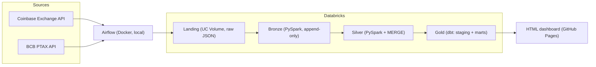

# Market Data Platform

A data engineering portfolio project built on real, daily-changing data: hourly crypto prices
(Coinbase Exchange) enriched with the official USD/BRL rate (BCB PTAX).

> Status: work in progress. Built step by step for learning. Not financial advice.

## Goal

Answer, with trusted and fresh data, questions an analyst would ask every day:

- What is the price of each asset in BRL (USD price x PTAX)?
- What are the daily return, 7-day volatility and moving averages?
- How much of the BRL return comes from the currency and not from the asset?
- Is the pipeline healthy (fresh, complete, no duplicates)?

## Architecture (planned)



Airflow is the only scheduler. It extracts from the APIs, triggers the Databricks job
(bronze and silver) and then runs `dbt build`.

## Data sources

| Source | Content | Frequency |
|---|---|---|
| Coinbase Exchange API | 1-hour candles, USD pairs | hourly |
| BCB PTAX (Olinda API) | USD/BRL closing bulletin | business days |

Raw data is not committed to this repository. See
[ADR 0001](docs/decisions/0001-data-sources.md) for the choices, rules and open licence question.

## Roadmap

- [x] 1. API tests and scope
- [ ] 2. Repository, folder structure and environment
- [ ] 3. Python extraction (retry and tests)
- [ ] 4. Landing and incremental bronze
- [ ] 5. Silver with MERGE and deduplication
- [ ] 6. dbt: project, staging and marts
- [ ] 7. Tests and quality (dbt + pytest)
- [ ] 8. Airflow: full DAG and backfill
- [ ] 9. CI with dev/prod
- [ ] 10. Automated dashboard and final docs

## Repository layout

```text
airflow/dags/       Airflow DAGs
src/market_data/    Python package (extraction and helpers), tested with pytest
notebooks/          Thin Databricks notebooks that call src/
tests/              Unit tests
docs/decisions/     Architecture decision records (ADRs)
dashboard/          Dashboard generator
.github/workflows/  CI
```
