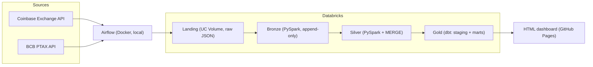

# Market Data Platform

Hourly crypto prices (Coinbase Exchange) enriched with the official USD/BRL rate (BCB PTAX),
built as a data engineering portfolio project: incremental ingestion, a Databricks medallion
architecture, dbt, Airflow and dev/prod environments.

> Status: work in progress (steps 1 to 3 of 10 done). Built step by step as a learning project.
> Not financial advice.

## Goal

Answer, with trusted and fresh data, the questions an analyst would ask every day:

- What is the price of each asset in BRL (USD price x PTAX)?
- What are the daily return, the 7-day volatility and the moving averages?
- How much of the BRL return comes from the currency and not from the asset?
- Is the pipeline healthy (fresh, complete, no duplicates)?

Planned KPIs for the gold layer: BRL price, daily return (USD and BRL), currency effect,
7-day volatility, 7 and 30-day moving averages, daily high/low range, BTC x ETH correlation, and
pipeline KPIs (freshness, completeness, duplicates).

## Architecture (planned)



Airflow is the only scheduler. It extracts from the APIs, uploads the raw JSON, triggers the
Databricks job (bronze and silver) and then runs `dbt build`.

### Why extraction runs outside Databricks

This is the unusual part of the design, so it is explained here.

The Databricks Free Edition limits outbound internet access to "a limited set of trusted domains"
([Databricks docs](https://docs.databricks.com/aws/en/getting-started/free-edition-limitations)),
without listing them. Instead of assuming, I tested it: a Python notebook on serverless compute
called both APIs with `requests`. Both calls failed with `NameResolutionError`, so the hostnames
`api.exchange.coinbase.com` and `olinda.bcb.gov.br` could not even be resolved. The same calls work
from a local machine.

So the flow is: Airflow (local) calls the APIs -> saves raw JSON -> uploads it to a Unity Catalog
Volume -> Databricks processes data that is already inside the workspace. Details and consequences
(the pipeline only runs while the local machine is on, backfill compensates for that) are in
[ADR 0002](docs/decisions/0002-extraction-in-airflow.md).

## How it was built, step by step

### Step 1 - Test the APIs and define the scope

**What:** called six public APIs from a local machine (Binance, Coinbase, Kraken, CoinGecko and the
BCB PTAX), then tested their hourly history for gaps and read their documentation.

**Why:** the source decides the whole design (limits, formats, time zones, licence), so it was
chosen with evidence and not by habit.

**Findings:**

- All APIs answered; Coinbase and Binance returned 7 days of hourly candles with no gaps (169 of 169).
- Coinbase returns rows newest first, at most 300 candles per request. Binance quotes BTCUSDT, and
  USDT is not USD, so Coinbase USD pairs fit the PTAX (a real USD rate) better.
- PTAX has one row per business day, in Brasilia time, and none on weekends or holidays, while
  crypto trades 24/7. A candle must only use a PTAX already published at that moment (no look-ahead).
- The licence of the exchange data is not confirmed, so no raw data is committed.

**Decision:** [ADR 0001](docs/decisions/0001-data-sources.md).

### Step 2 - Repository, folder structure and environment

**What:** a public repository, `.gitignore` first (before any code), an isolated virtual
environment, split dependency files, a README with the architecture diagram, an MIT licence for the
code and a `.env.example`.

**Why:** what enters the Git history cannot be removed, so secrets and data are ignored before
the first line of code. Runtime and development dependencies are separate (`requirements.txt`
and `requirements-dev.txt`) so production installs only what it needs.

### Step 3 - Extraction in Python

**What:** a tested Python package that fetches candles and PTAX and saves them as raw JSON.

| Module | What it does | Why |
|---|---|---|
| `windows.py` | Splits a long range into windows of up to 300 candles | The API limit per request |
| `http.py` | One GET helper with retry and exponential backoff on 429 and 5xx | Temporary failures must not break the pipeline |
| `coinbase.py` | Builds the candles request | Each API has its own request format |
| `extract.py` | Fetches a full range, drops duplicates and out-of-range rows, finds missing hours, saves the raw JSON | Complete data, kept exactly as received |
| `products.py` | Checks which pairs exist in the API (USD, online, trading enabled) | The pair list is never assumed |
| `pairs.py` | Extracts each pair on its own | A failure in one pair does not stop the others |
| `ptax.py` | Fetches PTAX and validates the response shape | Fail loudly if the API changes |
| `run_extraction.py` | Runs everything and prints a report | Manual entry point; exit code 1 on failure |

**Rules applied:** only closed candles (the open hour is never loaded), all timestamps in UTC, raw
data is never changed (it is wrapped in an envelope with source, range and ingestion time),
network and sleep are injected so tests run without internet.

## Verified results

Measured on 2026-10-23 against the real APIs:

| Check | Result |
|---|---|
| 10 USD pairs, last 48 closed hours | 48 of 48 candles each, 0 missing |
| BTC-USD, 720 hours (3 windows of 300, 300 and 120) | 720 of 720 candles, 0 missing |
| PTAX, last 14 days | 10 business-day bulletins |
| Unit tests (pytest, no network) | 58 passing |
| Lint (ruff, rules pinned in `ruff.toml`) | clean |

## Data sources

| Source | Content | Frequency |
|---|---|---|
| Coinbase Exchange API | 1-hour candles, USD pairs | hourly |
| BCB PTAX (Olinda API) | USD/BRL closing bulletin | business days |

## Roadmap

- [x] 1. API tests and scope
- [x] 2. Repository, folder structure and environment
- [x] 3. Python extraction (retry and tests)
- [ ] 4. Landing and incremental bronze
- [ ] 5. Silver with MERGE and deduplication
- [ ] 6. dbt: project, staging and marts
- [ ] 7. Tests and quality (dbt + pytest)
- [ ] 8. Airflow: full DAG and backfill
- [ ] 9. CI with dev/prod
- [ ] 10. Automated dashboard and final docs

## Repository layout

```text
airflow/dags/       Airflow DAGs (step 8)
src/market_data/    Python package: extraction code, tested with pytest
notebooks/          Thin Databricks notebooks that call src/
tests/              Unit tests
docs/decisions/     Architecture decision records (ADRs)
dashboard/          Dashboard generator (step 10)
.github/workflows/  CI (step 9)
ruff.toml           Pinned lint rules
```

## Quick start (Windows PowerShell)

```powershell
python -m venv .venv
.\.venv\Scripts\Activate.ps1
python -m pip install -r requirements-dev.txt
python -m pytest -q
python -m ruff check .
$env:PYTHONPATH = "src"
python -m market_data.run_extraction
```

The last command calls the public APIs and writes raw JSON under `data/landing/` (git-ignored).

## Lessons learned so far

- Test the network before designing around a platform: the Free Edition cannot resolve the API hosts.
- Read the API limits first: 300 candles per request, and the `end` parameter is inclusive
  (confirmed with a real run).
- Pin the lint configuration in the repository: default rules differ between ruff versions.
- A candle that is still open keeps changing, so only closed candles are ingested.
- Keep logic in `src/` as small functions and inject the network, so it can be tested offline.

## Data and licence

The code is MIT licensed. The data comes from third-party APIs under their own terms. The licence
of the crypto price data is not confirmed, so this repository contains code only, no raw data.
